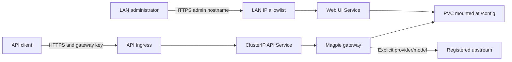

# Magpie Helm chart

This chart runs a persistent Magpie gateway with a local management UI.
It uses the official `ghcr.io/yetone/magpie` image and defaults to `image.tag: "latest"`.
Magpie releases frequently. Set the application version directly in your `values.yaml` with `image.tag`
(for example, `"0.1.1275"`), independently of the chart version.
The supported architectures are Linux amd64 and arm64.



The default Web UI binds to `127.0.0.1:3430` inside the Pod and uses a local tunnel.
Enabling `webui.ingress` binds it to `0.0.0.0:3430` behind a separate Service and protected HTTPS hostname.
The diagram shows that optional LAN Ingress mode.
The API uses port `3425` and requires enabled gateway keys for remote requests.
The chart uses Magpie's standard listener ports throughout its templates and first-run settings.

## Install

The chart creates a Web UI Secret with a random 48-character key during installation.
If the default Secret already exists, the chart reuses its key instead of generating a new one.

```sh
helm repo add korioinc https://korioinc.github.io/helm
helm repo update
helm upgrade --install magpie korioinc/magpie --namespace tools-magpie --create-namespace --wait
```

Repository installation requires a published chart release.
Before publication, install from the repository root with `./charts/magpie` instead of `korioinc/magpie`.

To pin the application version, create your own `values.yaml`:

```yaml
image:
  tag: "0.1.1275"
```

Pass it with `helm upgrade --install magpie korioinc/magpie --namespace tools-magpie -f values.yaml --wait`.
Only change `image.tag` for application updates; no chart release is needed.
A configured `image.digest` overrides the tag, so clear or replace it when changing versions.

| Setting | Purpose |
| --- | --- |
| `auth.existingSecret` | Empty by default: create or reuse `<fullname>-webui`. Set a name to reference an externally managed Secret without changing it |
| `auth.webKeySecretKey` | Secret field containing the Web UI key |
| `image.repository`, `image.tag`, `image.digest` | Image selection; defaults to `latest`. Set `image.tag` in `values.yaml` (e.g. `"0.1.1275"`) to pin a version; digest takes precedence |
| `persistence.storageClass` | Storage class; empty uses the cluster default, `-` disables dynamic provisioning |
| `persistence.size` | Requested volume size |
| `persistence.existingClaim` | Reuse an existing writable claim instead of creating one |
| `ingress.enabled` | Enable HTTPS access to the model API |
| `ingress.host` | Public hostname; also sets Magpie's advertised API URL |
| `ingress.className`, `ingress.annotations` | Ingress controller configuration |
| `ingress.tlsSecretName` | Existing TLS Secret in the release namespace |
| `webui.ingress.enabled` | Enable LAN administration through Traefik |
| `webui.ingress.host` | Admin hostname, separate from the API hostname |
| `webui.ingress.className`, `webui.ingress.annotations` | Admin Ingress configuration |
| `webui.ingress.tlsSecretName` | Existing TLS Secret for the admin hostname |

The chart defaults to the `latest` image tag and no Ingress. An image tag or digest must remain set.
An enabled Ingress requires a hostname and TLS Secret.
Ingress routes all paths to the API listener, including `/v1`, `/models`, `/muse-code/models`, and `/v1beta`.
Management endpoints stay on the separate Web UI listener.
The optional admin Ingress requires a distinct hostname and an existing Traefik access middleware.
Set `webui.ingress.annotations.traefik.ingress.kubernetes.io/router.middlewares` to the appropriate private-access rule.
The middleware must restrict access to trusted networks; the chart cannot verify its policy.
The chart preserves this annotation and creates no additional middleware or Traefik CRD.
Use LAN DNS pointing to the private Ingress entrypoint, so LAN browsers reach it directly.
API Ingress annotations and paths remain independent of administration.

## Web UI Secret lifecycle

By default, the Secret is `<fullname>-webui` in the release namespace (`magpie-webui` for the commands above).
The key is stored in `auth.webKeySecretKey`, which defaults to `web-key`.
A generated key has 48 random alphanumeric characters. Existing keys must have at least 16 characters
and use only letters, digits, or `-._~`. A missing or invalid key fails installation or upgrade; it is never silently replaced.

The chart reads the existing Secret through Helm `lookup` and preserves its data during upgrades.
A Secret managed by this release is retained on uninstall with `helm.sh/resource-policy: keep`.
Reinstalling with the same release name, namespace, and fullname reuses that key.
A pre-existing unmanaged Secret is only referenced, not adopted or changed.
A Secret owned by another Helm release requires explicit `auth.existingSecret` to avoid accidental sharing.

To use an external Secret, set:

```yaml
auth:
  existingSecret: my-magpie-webui
  webKeySecretKey: web-key
```

This path does not create, read, validate, or modify the Secret; provide a valid key before the Pod starts.
For older installations that used the fixed `magpie-webui` default with a different release/fullname,
set `auth.existingSecret: magpie-webui` before upgrading to preserve the existing login key.

Automatic reuse requires Helm to access the cluster API and read Secrets in the release namespace.
`helm template` and client-side dry runs cannot look up existing keys and generate a fresh preview key each time.
For offline-rendered GitOps deployments, manage the Secret externally and set `auth.existingSecret`.
Use `--dry-run=server` for a cluster-aware preview; rendered manifests contain credentials, so keep output private.
Helm release history also contains generated credentials. Restrict access to Secrets and release records.
Helm rollback restores stored manifests without `lookup` and can restore an older key after manual rotation.
Use an externally managed Secret when key rotation must remain independent of Helm history.

## Configure providers and clients

With LAN Ingress enabled, open `https://<webui.ingress.host>/?k=<web-key>` from an allowed source network.
With the default loopback mode, start a tunnel on the administrator's computer:

```sh
kubectl --namespace tools-magpie port-forward deployment/magpie 3430:3430 --address 127.0.0.1
```

Retrieve the Web UI key (use the Secret name and field shown in Helm NOTES if overridden):

```sh
kubectl --namespace tools-magpie get secret magpie-webui \
  -o jsonpath='{.data.web-key}' | base64 --decode
```

For loopback mode, open `http://127.0.0.1:3430/?k=<web-key>`.
Use the release's actual deployment name when it differs.

1. Add providers or supported subscription accounts in the Web UI.
2. Register vLLM or CLIProxyAPI as custom OpenAI-compatible providers when needed.
3. Use each upstream's reachable URL, such as its Kubernetes Service DNS name.
4. Refresh the model list and select the models to expose.
5. Create a named gateway key for each API client under **Gateway → Gateway keys**.
6. Request the full `provider/model` ID returned by `/v1/models`.

The chart creates no gateway keys. A new installation rejects all remote API requests until a key exists.
Web UI keys and API gateway keys are independent.

New installations disable automatic routing groups and automatic image description or image-model selection.
The chart seeds `settings.json` and `providers.json` only when each file is absent.
It preserves subsequent Web UI changes, account credentials, provider configuration, and named gateway keys.
Do not enable provider fallback lists, routing groups, model remapping, or vendor `Auto` models for fixed model selection.
An administrator can change these policies in the Web UI; the chart does not lock application settings.
An existing or restored volume keeps its policies. Review them before reconnecting clients.

For Codex OAuth, copy the final `http://localhost:1455/auth/callback?...` URL into the Web UI's callback field.
The browser's failed localhost redirect is expected when the callback listener runs inside Kubernetes.
No public OAuth callback route is required. Other provider login flows require their own verification.

The official image does not contain Claude Code. Claude subscription forwarding requires an image that includes it.
An Anthropic API-key provider or a suitable external upstream does not require that local executable.
When using a custom image, set its repository and tag and clear or replace `image.digest`.
The image must retain `/magpie`, `/bin/sh`, and writable HOME/XDG directories under `/config`.

## Verify after deployment

Use the public endpoint for authentication checks. API port-forwarding reaches loopback and bypasses remote authentication.
With sharing enabled, the first request below should return `401`:

```sh
curl -i https://magpie.example.com/v1/models
curl --fail-with-body https://magpie.example.com/v1/models \
  -H "Authorization: Bearer $MAGPIE_GATEWAY_KEY"
curl --fail-with-body https://magpie.example.com/v1/chat/completions \
  -H "Authorization: Bearer $MAGPIE_GATEWAY_KEY" \
  -H 'Content-Type: application/json' \
  -d '{"model":"<provider>/<model>","messages":[{"role":"user","content":"Hello"}],"stream":true}'
```

Use `https://<host>/v1` for OpenAI-compatible clients, including Codex Responses requests.
Use `https://<host>` for Anthropic-compatible clients, including Claude Code.
Client model catalogs and protocol support still need verification with the actual client and upstream.
Test provider selection, upstream errors without model substitution, streaming, tool calls, and restart persistence.

## Storage, updates, and access

The Pod runs as UID/GID `65532`, with `fsGroup: 65532` for the claim.
`/config` holds accounts, API credentials, plugins, catalogs, and application state.
Back up that volume and restrict access to it. Claim annotations retain newly created storage on Helm uninstall.
An existing claim must be writable by the container user. Local storage remains tied to its Kubernetes node.

The deployment uses one replica and `Recreate` updates to avoid concurrent file writers.
Updates cause downtime and can interrupt active streams; Magpie's Web mode does not guarantee stream draining.
Do not run two releases against the same claim. Retained claims require explicit adoption or `existingClaim` on reinstall.
First-run settings disable application auto-update, and the read-only root filesystem protects the installed binary.
Change `image.tag` in your `values.yaml` when updating the application (for example, `"0.1.1275"`).
A configured digest takes precedence over the tag.
`Chart.yaml` `version` identifies the chart package; it does not select the application image.
The chart omits `appVersion` because application versions are selected independently.

The default `image.pullPolicy: Always` resolves `latest` whenever a Pod starts.
It does not update running Pods, and a Helm upgrade with unchanged values does not trigger a restart.
Use `kubectl --namespace tools-magpie rollout restart deployment/magpie` to fetch a newer `latest` image.
A mutable tag can change on any Pod restart; pin a release tag or digest for reproducible deployments.
Restart the deployment after rotating the Web UI Secret.

The chart explicitly clears the image's `MAGPIE_ADDR` override.
Sharing then controls the API listener and its remote authentication.
Disabling sharing closes external API access.
With admin Ingress enabled, readiness checks the gateway's loopback health, keeping the admin Service available.
With loopback-only administration, API TCP readiness still removes unreachable public endpoints.
Keep the Gateway port in Settings at its default `3425`; changing it in the Web UI disconnects the Service.
For a restored volume with another Gateway port, set it back through the Web UI.

Ingress must forward to the Pod IP through the API Service.
A proxy in the same Pod that forwards through loopback would bypass native gateway authentication.
Magpie prints a Web UI login link during startup, so treat application logs as sensitive.
Its printed network link may use `MAGPIE_PUBLIC_URL`, which belongs to the API host.
Use the admin hostname from Helm NOTES or your `values.yaml` for browser login.
The chart does not enable request-body logging or telemetry.

Configure streaming timeouts in the chosen Ingress controller. Avoid response-buffering middleware.
This chart does not change shared controller settings.

## Verification commands

```sh
# Run from the korioinc/helm repository root.
helm lint ./charts/magpie --strict
helm template magpie ./charts/magpie --namespace tools-magpie
helm package ./charts/magpie --destination /tmp
```

Add `-f values.yaml` to lint or render your installation overrides.

## Upstream evidence

The original chart implementation was checked against Magpie `0.1.1024`, commit `528d6c12dc11558f55aa00a39c7ba988c83520eb`.
The installed image is selected by installation values. The links below record the original runtime review.

- [Docker image and filesystem layout](https://github.com/yetone/magpie/blob/528d6c12dc11558f55aa00a39c7ba988c83520eb/Dockerfile)
- [Listener selection and remote authentication](https://github.com/yetone/magpie/blob/528d6c12dc11558f55aa00a39c7ba988c83520eb/internal/gateway/lan.go)
- [Automatic routing groups](https://github.com/yetone/magpie/blob/528d6c12dc11558f55aa00a39c7ba988c83520eb/internal/provider/group.go)
- [Headless Web UI and OAuth callback instructions](https://github.com/yetone/magpie/blob/528d6c12dc11558f55aa00a39c7ba988c83520eb/docs/reference.md#docker)
